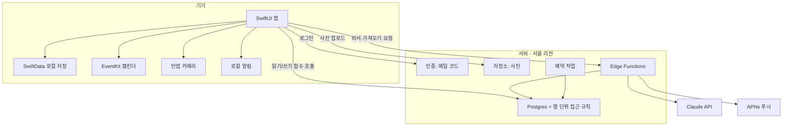
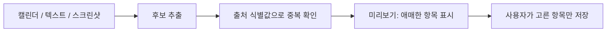
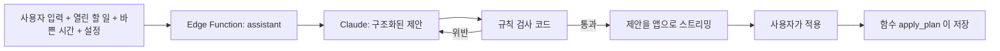
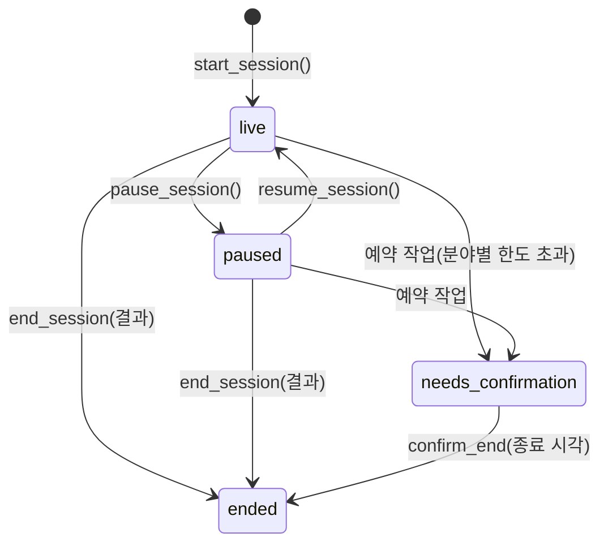
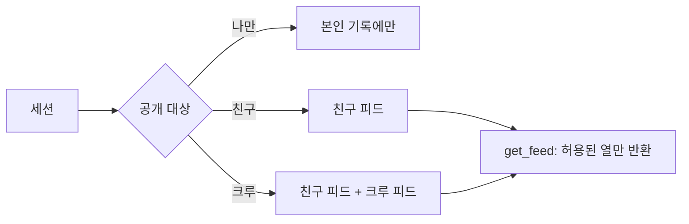

# SRD — 시스템 요구사항·설계 문서

- 문서 버전: v0.4 (2026-11-22)
- v0.4 변경: 문서 계층과 개발 순서, 사전 검증, 비서 시험 세트, 예상 시간 보정, 같이 하기, 크루 반영
- 짝 문서: [PRD.md](./PRD.md)
- 전제: 1인 개발, AI 코딩 도구를 주로 사용, iPhone 우선

---

## 1. 기술 선택

| 영역 | 선택 | 이유 |
|---|---|---|
| 앱 | SwiftUI, iOS 17 이상 | 캘린더(EventKit), 카메라, 알림을 직접 쓴다. iOS 17부터 캘린더 권한 방식이 바뀌어 하한으로 삼는다 |
| 기기 저장 | SwiftData | 오프라인에서도 오늘 화면과 기록이 바로 뜬다 |
| 서버 | Supabase (Postgres, 인증, 저장소, Edge Functions), 서울 리전 | 서버를 직접 운영하지 않는다. 함수와 DB가 같은 리전에 있다 |
| AI | Claude API, 서버 함수 경유 | 키를 앱에 넣지 않는다 |
| 푸시 | APNs | 서버 함수에서 발송 |
| 메일 발송 | 전용 발송 서비스(SMTP 연결) | 기본 발송은 발송량 제한이 낮다 |
| 배포 | TestFlight → App Store | Apple 개발자 계정 필요(연 유료) |

AI 모델은 미리 정하지 않고 시험 세트 결과로 정한다(3.6절). 기준선은 `claude-opus-5-5`로 잡고, 같은 세트를 `claude-sonnet-5-5`와 `claude-haiku-5-5`로 돌려 통과율이 유지되는 가장 싼 모델을 요청 종류별로 고른다. 가격 차이가 크므로(입력 100만 토큰당 Opus 5.5 4달러, Sonnet 5.5 2달러, Haiku 5.5 0.1달러) 이 결정이 사용자당 비용을 좌우한다.

## 2. 전체 구조

원칙 세 가지.

1. **비공개 계획 데이터와 공유 데이터를 테이블과 접근 규칙에서 나눈다.** 피드는 공유용으로 허용된 열만 읽는다.
2. **시각과 상태 변경은 서버 함수가 정한다.** 앱이 세션 테이블에 직접 쓰지 못한다.
3. **비서는 제안만 돌려준다.** 저장은 사용자가 적용할 때 별도 함수가 한다.

## 3. 파이프라인

### 3.1 가져오기

- **캘린더**: 기기에서만 읽는다. 일정 제목과 메모는 서버로 보내지 않고 기기에 둔다. 계획 요청 때 바쁜 시간 구간(시작, 끝)만 보낸다.
- **권한**: 일정을 읽으려면 iOS의 "전체 접근" 권한이 필요하다. 읽기 전용 권한은 따로 없으므로 "원본을 수정하지 않는다"는 것은 앱이 코드로 지키는 약속이다. 쓰기 API는 호출하지 않는다.
- **갱신 시점**: 앱 실행, 앱 복귀, 계획 생성 직전. 마지막 갱신 시각을 저장한다.
- **텍스트·스크린샷**: 서버 함수 `import-extract`가 후보 목록을 구조화해 돌려준다. 이미지는 처리 후 저장하지 않는다.
- **중복 방지**: `(user_id, source, source_ref)` 고유 제약. 캘린더는 일정 식별자, 텍스트·이미지는 정규화한 제목+날짜의 해시.
- 가져온 완료 표시는 `completion_source = 'imported'`로만 남고 세션을 만들지 않는다.

### 3.2 비서

- 요청 종류 3개: `capture`(할 일 정리), `plan_day`(하루 배치), `reschedule`(재배치).
- 모델 출력은 구조화 출력(JSON 스키마)으로 받는다. 형식은 `assistant/core/schema.mjs`에 있고 `todos`, `blocks`, `done_todo_ids`, `unscheduled`, `questions`, `message` 여섯 항목이다. `message`만 글자 단위로 흘려보낸다.
- **규칙 검사는 모델이 아니라 코드가 한다**: 시간 겹침, 고정 일정 침범, 마감 초과, 활동 가능 시간대, 사용자가 잠근 계획. 위반하면 한 번 재요청하고, 다시 실패하면 위반 항목을 뺀 안을 보여 준다.
- 비서가 할 수 있는 일은 출력 형식의 여섯 항목이 전부다. 세션 생성, 세션 시각 변경, 공개 범위 변경은 형식에 없어서 모델이 시도할 방법이 없다. 도구 호출은 쓰지 않는다.
- 가져온 텍스트와 일정 제목은 **데이터로만** 전달한다. 그 안의 문장을 지시로 따르지 않도록 프롬프트에서 구획을 나누고, 따르더라도 규칙 검사와 출력 형식이 피해를 막는다.
- **예상 시간 보정**은 모델이 아니라 코드가 한다. 분야별로 최근 완료한 할 일의 (실제 세션 시간 합 ÷ 예상 시간) 중앙값을 보정 배수로 삼는다. 표본이 5개 이상일 때만 쓰고 0.5~3.0 범위로 제한한다. 비서에는 보정된 예상 시간을 입력으로 주고, 화면에는 보정했다는 사실과 배수를 보여 준다.
- 한도: 사용자당 하루 호출 수 제한, 요청당 시간 제한 20초, 실패 시 직접 입력 화면으로 이동.
- 모든 호출을 `assistant_runs`에 기록한다(종류, 토큰 수, 걸린 시간, 성공 여부). 대화 원문은 기본 저장하지 않는다.

### 3.3 세션

- 모든 전이는 DB 함수로만 한다. `started_at`, `ended_at`은 DB의 `now()`.
- 진행 중 세션 1개 제한: `status in ('live','paused')`에 대한 사용자별 부분 고유 인덱스.
- 일시 정지 시간은 `paused_seconds`로 따로 쌓고 세션 시간에서 뺀다.
- 예약 작업(10분마다): 분야별 한도(예: 공부 4시간, 알바 10시간)를 넘긴 진행 중 세션을 `needs_confirmation`으로 바꾼다. 이 상태의 세션은 피드에서 빠지고 누적에 들어가지 않는다.
- `confirm_end`로 사용자가 종료 시각을 정하면 `end_corrected = true`가 되고 카드에 `나중에 정정함`이 붙는다. 원래 이벤트는 `session_events`에 남는다.
- 사진: 기기에서 2종 크기로 줄여 올린다(4.2절). 세션 시작은 사진 업로드를 기다리지 않는다.
- 오프라인 시작: 기기에 기록했다가 연결되면 `start_session(offline_started_at)`으로 보낸다. 서버는 수신 시각을 함께 저장하고 `오프라인 시작`으로 표시한다.

### 3.4 공유

- 피드는 테이블을 직접 읽지 않고 `get_feed(cursor, limit)` 함수로만 읽는다. 반환 열: 작성자, 공유용 제목, 분야, 시작 시각, 상태, 진척 메모, 사진 경로, 기록 방식 표시, 반응 수.
- 개인 제목, 연결된 할 일, 계획, 비서 기록은 피드 함수가 반환하지 않는다.
- 공개 대상은 `private / friends / crew / department / school` 5단계로 정의하고 `department`와 `school`은 꺼 둔다. 나중에 켜도 기존 게시물의 범위는 바뀌지 않는다.
- 같이 하기: `start_session(joined_session_id)`로 시작한다. 서버는 상대 세션이 진행 중이고 내가 볼 권한이 있는지 확인한다. 연결은 표시용이며 상대 세션의 시각이나 상태에 영향을 주지 않는다.
- 차단한 사용자의 세션은 양방향으로 보이지 않는다.

### 3.5 개발·배포

문서는 네 층이다. AI 코딩 도구에는 맨 아래 한 장만 준다.

**PRD(왜, 무엇) → SRD(규칙, 구조) → 마일스톤별 작업 명세(`docs/specs/`) → 코드**

마일스톤 하나는 이 순서로 진행한다.

1. **명세 작성**: SRD의 해당 절에서 화면, 서버 함수의 입력·출력, 통과 테스트를 뽑는다.
2. **테스트 먼저**: 접근 규칙과 서버 함수 테스트를 먼저 만든다.
3. **서버 구현**: DB와 함수를 먼저 완성한다. 앱 없이 검증된다.
4. **앱 구현**: 완성된 서버 함수에 화면을 붙인다.
5. **자동 검사**: 빌드, 테스트, 키 노출 검색.
6. **실물 확인**: 기준 기기와 느린 통신에서 4.1절 수치를 본다.
7. **배포**: TestFlight에 올리고 문서를 갱신한다.

| 환경 | 내용 |
|---|---|
| 로컬 | Xcode 시뮬레이터 + Supabase 로컬 환경, DB 변경은 마이그레이션 파일로만 |
| 내부 배포 | TestFlight, 지인 20~30명(실제 크루 2~3개) |
| 출시 | App Store 심사 |

### 3.6 비서 시험 세트

비서의 프롬프트, 출력 형식, 규칙 검사는 `assistant/core/`에 있고 서버 함수와 시험 세트가 같은 코드를 쓴다. 시험 세트는 `assistant/eval/`에 있다.

- 사례 48개: 할 일 정리 20, 하루 배치 16, 재배치 12. 각 사례에 입력, 기대, 사람이 쓴 모범 답이 있다.
- 채점은 코드로만 한다. 지표는 `pass`(전체 통과), `rules_ok`(규칙 위반 없음), `no_invented_due`(말하지 않은 기한을 만들지 않음), `no_false_done`(끝냈다고 하지 않은 일을 완료 처리하지 않음).
- 통과 기준: `rules_ok`, `no_invented_due`, `no_false_done`는 100%, `pass`는 90% 이상. 미달이면 M4를 시작하지 않고 프롬프트를 고친다.
- 프롬프트, 형식, 규칙, 모델 중 하나라도 바꾸면 다시 돌린다.
- 한계: 사례가 전부 지어낸 문장이다. 테스트 그룹의 실제 입력이 모이면 교체한다. 48개를 2번씩 돌릴 때 통과율 오차는 약 ±10%p라서 그보다 작은 차이는 의미가 없다.

## 4. 성능 요구사항

요청하신 항목은 대부분 웹 기준 표현이라, iPhone 네이티브 앱에 맞는 형태로 옮겼다. 해당하지 않는 항목은 그렇게 표시했다.

### 4.1 목표 수치

기준 기기는 iOS 17을 지원하는 가장 오래된 급(iPhone XR·SE 2세대), 기준 통신은 느린 LTE.

| 항목 | 목표 |
|---|---|
| 앱 실행 후 오늘 화면 표시 | 2초 이내(로컬 데이터로 먼저 그림) |
| 탭 전환 시 뼈대 화면 | 0.1초 이내 |
| 피드 첫 화면 | 1초 이내(75% 사용자 기준) |
| `지금 시작` 누른 뒤 화면 반응 | 0.1초 이내(서버 응답을 기다리지 않음) |
| 일반 요청 서버 응답 | 0.3초 이내(95% 요청 기준) |
| 비서 첫 글자 표시 | 1.5초 이내 |
| 사진 한 장 크기 | 큰 것 400KB 이하, 작은 것 60KB 이하 |
| 스크롤 | 초당 60프레임 유지 |

### 4.2 항목별 적용

**화면과 체감 속도**

| 요청 | 적용 방법 |
|---|---|
| 로딩엔 뼈대 화면 먼저 | 모든 목록 화면에 뼈대 표시. 오늘·기록은 로컬 저장분을 먼저 그린 뒤 서버 값으로 갱신 |
| 답보다 화면 먼저 바꾸기 | 세션 시작·종료, 할 일 체크, 반응은 누르는 즉시 화면을 바꾸고 서버 전송은 뒤에서. 실패하면 되돌리고 알림 |
| AI 답은 한 글자씩 | 서버 함수가 스트리밍으로 전달, 앱이 받는 대로 표시 |
| 긴 목록은 보이는 만큼만 | `LazyVStack`/`List`로 보이는 행만 그림 |
| 다시 그리기 줄이기 | 화면 상태를 잘게 나누고(Observation), 행마다 고정 식별값 사용, 타이머 숫자는 그 글자만 갱신 |
| 글꼴 굵기 줄이기 | 시스템 글꼴만 쓴다. 내려받는 글꼴이 없어 해당 문제 자체가 없다 |

**사진**

| 요청 | 적용 방법 |
|---|---|
| 사진은 WebP로 가볍게 | iPhone은 WebP로 저장하는 기능이 기본 제공되지 않는다. 같은 수준으로 가벼운 HEIC로 올린다. 사용자가 전부 iPhone이라 호환 문제가 없다. 웹 화면이 생기면 서버에서 WebP로 변환한다 |
| (추가) 크기 줄이기 | 촬영 직후 기기에서 긴 변 1600px와 480px 2종을 만든다. 피드는 작은 것만, 상세에서 큰 것 |
| 아래 사진은 나중에 받기 | 화면에 들어올 때 받기 시작하고, 벗어나면 취소 |
| 파일은 가까운 서버에서 | 저장소의 CDN 경유 |
| 파일은 브라우저에 저장 | 기기 디스크 캐시(경로를 키로, 용량 상한 설정). 사진은 수정되지 않으므로 만료 없이 보관 |
| 보내는 파일은 압축 | 사진은 위와 같이 축소, 요청·응답 본문은 gzip |
| 느린 일은 뒤에서 | 사진 업로드는 백그라운드 전송으로. 앱을 닫아도 이어진다 |

**요청**

| 요청 | 적용 방법 |
|---|---|
| 같은 요청은 한 번만 | 진행 중인 같은 요청은 하나로 합친다. 쓰기 요청에는 중복 방지 키를 붙여 재시도해도 한 번만 반영 |
| 검색은 입력 멈추면 | 친구 검색은 입력이 0.3초 멈춘 뒤 요청, 이전 요청은 취소 |
| 결과는 나눠서 | 피드·기록은 20개씩, 마지막 항목 기준으로 다음 묶음(커서 방식) |
| 데이터는 몰아서 한 번에 | 화면 하나에 함수 하나: `get_today()`, `get_feed()`, `get_record_summary()`. 행마다 추가 요청을 보내지 않는다 |
| 따로인 요청은 동시에 | 서로 무관한 요청은 `async let`으로 동시에 |
| 필요한 열만 | 함수가 화면에 쓰는 열만 반환. `select *` 금지 |
| 바깥 요청엔 시간 제한 | 일반 요청 10초, 비서 20초, 사진 업로드 60초. 재시도는 간격을 늘려 2회까지 |
| 자주 쓰는 건 저장 | 프로필, 친구 목록, 오늘 계획은 기기에 저장하고 뒤에서 갱신 |

**서버와 데이터베이스**

| 요청 | 적용 방법 |
|---|---|
| 서버는 데이터 바로 옆 | DB와 함수 모두 서울 리전. 가능한 로직은 DB 함수로 두어 왕복을 줄인다 |
| 자주 찾는 데이터엔 색인 | 5절의 인덱스 목록 |
| DB 연결은 돌려쓰기 | 연결 풀러 사용(Supabase 기본 제공). 함수에서 직접 연결을 새로 열지 않는다 |
| 느린 일은 뒤에서 | 푸시 발송, 누적 집계, 종료 확인 처리는 예약 작업과 대기열로 |
| 느린 요청은 추적 | 느린 질의 통계 확인(`pg_stat_statements`), 함수별 걸린 시간 기록, 0.5초 넘는 요청은 따로 표시 |
| 손님은 여러 서버로 | 관리형 서비스가 처리한다. MVP 규모(수백 명)에서는 직접 할 일이 없다. 병목은 DB에서 먼저 나오므로 인덱스와 질의를 본다 |

**앱 크기와 구성**

| 요청 | 적용 방법 |
|---|---|
| 안 쓰는 부품은 빼기 | 외부 라이브러리는 Supabase SDK와 이미지 캐시 정도로 제한. 추가할 때마다 이유를 적는다 |
| 남의 코드는 나중에 | 분석·오류 수집 도구는 첫 화면이 뜬 뒤 초기화 |
| 코드는 페이지별로 나누기 | 웹 전용 기법이다. 네이티브 앱은 한 덩어리로 설치되므로 해당 없음. 대신 실행 시 하는 일을 줄인다 |
| 페이지는 미리 만들기 | 앱에는 해당 없음. 초대 링크를 여는 웹 페이지 한 장에만 적용(정적 페이지) |

**측정과 시험**

| 요청 | 적용 방법 |
|---|---|
| 실제 사용자 속도 보기 | MetricKit으로 실행 시간·멈춤·메모리를 수집, 주요 화면에 구간 측정(signpost) |
| 느린 폰에서 시험 | 기준 기기 실물로 마일스톤마다 확인 |
| 느린 인터넷에서 시험 | 네트워크 속도 제한 도구(Network Link Conditioner)의 3G·손실 설정으로 확인 |

아직 앱이 없어 지금 시험할 수는 없다. 위 수치는 각 마일스톤의 통과 조건으로 넣는다.

## 5. 데이터 모델

| 테이블 | 주요 열 | 비고 |
|---|---|---|
| `schools` | id, name, email_domains[] | 학교 추가는 행 추가 |
| `departments` | id, school_id, name | |
| `profiles` | id(=auth), school_id, handle, display_name, department_id, avatar_path | 학과는 자기 선택 |
| `friendships` | user_a, user_b, status, requested_by | 작은 id를 user_a로 고정 |
| `groups` | id, school_id, kind(crew/department), name, owner_id, invite_code | MVP는 crew만 |
| `group_members` | group_id, user_id, role, status(active/removed) | 초대 링크로 입장 |
| `estimate_stats` | user_id, primary_category, factor, sample_count, updated_at | 예상 시간 보정 배수 |
| `threads` | id, user_id, title, share_title, primary_category, default_visibility, archived_at | 이어가는 일 |
| `todos` | id, user_id, thread_id, title, due_at, estimate_min, status, completed_at, completion_source, source, source_ref | 비공개 |
| `plan_blocks` | id, user_id, todo_id, thread_id, start_at, end_at, locked, origin(user/assistant), status | 비공개 |
| `sessions` | id, user_id, thread_id, todo_id, plan_block_id, primary_category, tags[], started_at, ended_at, paused_seconds, status, outcome, capture_mode, photo_path, share_title, progress_note, visibility, end_corrected, offline_started_at, joined_session_id | |
| `session_events` | id, session_id, type, at, payload | 추가만 가능 |
| `reactions` | session_id, user_id, kind | |
| `comments` | id, session_id, user_id, body | |
| `blocks` | blocker_id, blocked_id | |
| `reports` | id, reporter_id, session_id, reason, status | |
| `device_tokens` | user_id, token | 푸시 |
| `assistant_runs` | id, user_id, kind, model, input_tokens, output_tokens, latency_ms, ok | 비용·속도 추적 |
| `daily_stats` | user_id, day, primary_category, seconds, session_count | 종료 시 갱신하는 집계 |

값 목록.

- `primary_category`: study, coding, exercise, project, venture_research_intern, parttime
- `sessions.status`: live, paused, ended, needs_confirmation
- `sessions.outcome`: done, more, stop
- `sessions.capture_mode`: in_app_photo, no_photo
- `visibility`: private, friends, crew, department(비활성), school(비활성)
- `todos.completion_source`: user_action, user_statement, imported

인덱스.

- `sessions (user_id, started_at desc)`
- `sessions (user_id) where status in ('live','paused')` 고유
- `sessions (started_at desc) where visibility <> 'private'`
- `friendships (user_a, status)`, `friendships (user_b, status)`
- `group_members (user_id, status)`
- `todos (user_id, status, due_at)`
- `todos (user_id, source, source_ref)` 고유
- `plan_blocks (user_id, start_at)`
- `daily_stats (user_id, day)`

## 6. 서버 함수 목록

| 함수 | 종류 | 하는 일 |
|---|---|---|
| `start_session`, `pause_session`, `resume_session`, `end_session`, `confirm_end` | DB | 세션 상태 전이 |
| `get_today` | DB | 오늘 계획, 할 일, 진행 중 세션을 한 번에 |
| `get_feed(cursor, limit)` | DB | 친구·크루 피드 |
| `get_record_summary(range)` | DB | 잔디, 분야별 시간 |
| `apply_plan(proposal)` | DB | 비서 제안을 검사 후 저장 |
| `assistant` | Edge | capture / plan_day / reschedule, 스트리밍 |
| `import-extract` | Edge | 텍스트·이미지에서 후보 추출 |
| `notify` | Edge | 푸시 발송(대기열 소비) |
| `delete_account` | Edge | 계정과 데이터, 사진 삭제 |
| 예약 작업 | DB | 종료 확인 필요 전환, 집계 보정 |

## 7. 보안과 개인정보

- 모든 테이블에 행 단위 접근 규칙을 켠다. 기본은 "본인 것만".
- 앱에는 공개용 키만 넣는다. 관리자 키와 AI 키는 서버 함수 환경 변수에만 둔다.
- 가입은 `schools.email_domains`에 있는 도메인만 허용. 서버에서 검사한다.
- 사진은 비공개 저장소에 두고, 볼 권한이 있는 사용자에게만 기한 있는 주소를 발급한다.
- 캘린더 일정의 제목과 메모는 기기를 떠나지 않는다. 서버와 AI로는 바쁜 시간 구간만 간다.
- AI로 보내는 것: 사용자가 입력한 문장, 열린 할 일의 제목, 바쁜 시간 구간, 설정. 첫 사용 전 동의 화면에서 이 목록을 보여 준다.
- 권한 설명 문구: 카메라, 캘린더, 알림. 사진 보관함 권한은 요청하지 않는다(스크린샷 가져오기는 시스템 선택 화면을 써서 권한이 필요 없다).
- 신고가 들어온 게시물은 운영자 확인 전까지 신고자에게 숨긴다.

## 8. 마일스톤

마일스톤 하나가 끝날 때마다 그 상태로 쓸 수 있는 앱이 되도록 순서를 잡았다.

M0 전에 앱 없이 확인할 수 있는 것 세 가지를 먼저 본다. 가장 불확실한 비서가 M4에 있어서, 틀렸다는 것을 늦게 알지 않기 위해서다.

| 사전 검증 | 방법 | 결과에 따른 결정 |
|---|---|---|
| 비서 품질 | 시험 세트(3.6절)를 기준선 모델로 실행 | 통과 기준 미달이면 프롬프트 수정. 싼 모델로도 통과하면 그 모델 채택 |
| 고려대 메일 수신 | 인증 코드 메일을 실제 주소 몇 개로 발송 | 스팸으로 빠지면 발송 도메인 인증부터 |
| 에브리타임 캘린더 연동 | 시간표가 iPhone 캘린더에 생기는지 확인 | 생기면 스크린샷 가져오기를 MVP에서 뺀다 |

| 단계 | 내용 | 통과 조건 |
|---|---|---|
| M0 기반 | 프로젝트, 서버, 메일 인증, 프로필 | 고려대 메일로 가입되고 다른 도메인은 거절된다 |
| M1 세션 | 시작·정지·종료, 인앱 카메라, 기록 탭, 종료 확인 필요 | 혼자서 기록 앱으로 쓸 수 있다. 시각 조작 요청이 서버에서 거절된다 |
| M2 함께 | 친구, 피드, 반응, 같이 하기, 차단·신고 | 다른 사용자의 비공개 세션이 어떤 경로로도 읽히지 않는다. 볼 권한이 없는 세션에는 같이 하기가 거절된다 |
| M3 계획 | 할 일, 이어가는 일, 캘린더 읽기, 오늘 탭, 로컬 알림 | 알림에서 두 번 안에 세션이 시작된다 |
| M4 비서 | 할 일 정리, 하루 배치, 재배치, 예상 시간 보정 | 규칙 검사를 통과하지 못한 계획이 저장되지 않는다. 시험 세트 통과 기준 충족. 첫 글자 1.5초 |
| M5 마무리 | 텍스트·스크린샷 가져오기, 크루, 푸시, 계정 삭제, 성능 시험 | 4.1절 수치를 기준 기기와 느린 통신에서 만족 |

일정이 밀리면 PRD의 P1 항목(스크린샷 가져오기, 크루, 자동 재배치, 주간 돌아보기, 푸시)부터 뺀다.

마일스톤별 작업 명세는 `docs/specs/`에 둔다. M0은 [specs/M0.md](./specs/M0.md).

## 9. AI 코딩 도구로 만들 때의 규칙

코드 대부분을 AI가 작성한다는 전제에서, 사람이 직접 확인해야 하는 지점을 정해 둔다.

1. **한 번에 마일스톤 하나만 시킨다.** 이 문서의 해당 절과 통과 조건을 함께 준다.
2. **DB 변경은 마이그레이션 파일로만 한다.** 화면에서 직접 고친 변경은 기록이 남지 않는다.
3. **접근 규칙은 테스트로 확인한다.** "사용자 B로 로그인해서 A의 비공개 데이터를 읽어 본다"는 테스트를 테이블마다 둔다. AI가 만든 규칙은 그럴듯해 보여도 뚫려 있는 경우가 있다.
4. **키는 직접 관리한다.** 앱 코드나 저장소에 관리자 키·AI 키가 들어갔는지 커밋 전에 검색한다.
5. **외부 라이브러리 추가는 승인제로 한다.** AI가 편의상 추가한 패키지가 앱을 무겁게 한다.
6. **성능 수치는 실물 기기에서 본다.** 시뮬레이터는 실제보다 빠르다.

## 10. 열린 항목

| 항목 | 결정 시점 |
|---|---|
| 앱 이름 | M0 전 |
| 분야별 세션 한도 시간 | M1 |
| 비서 일일 호출 한도 | M4, 테스트 그룹 사용량을 본 뒤 |
| 요청 종류별 비서 모델 | 2026-11-23 시험 결과: Opus 5.5만 통과 기준을 전부 충족. 사용자 결정 대기(전부 Opus, 또는 할 일 정리만 Sonnet). 결과는 PROGRESS.md |
| 에브리타임 캘린더 연동 동작 확인 | M3 전 |
| 고려대 메일의 인증 코드 수신 여부 | M0 |
| 학과 목록 데이터 출처 | M0 |
